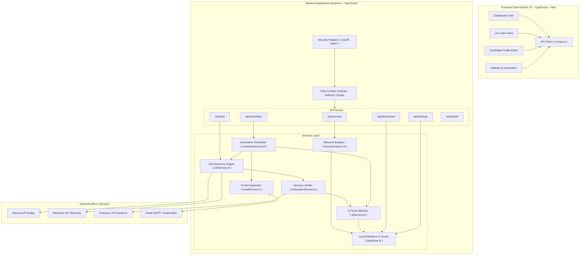

# JobPulse AI 🚀

> **AI-Powered Resume-Driven Job Discovery, Live Vacancy Verification & Automated Career Alerts**

JobPulse AI is an intelligent job search and matching platform that bridges the gap between candidates and legitimate career opportunities. Instead of relying on generic keyword searches, JobPulse AI parses uploaded resumes across diverse engineering and professional disciplines, constructs a structured candidate profile, discovers vacancies from verified job feeds, validates application link accessibility using an SSRF-guarded verification engine, and delivers personalized recommendations and daily email alerts.

**Repository Destination**: [https://github.com/Pratikshaprabhakarbande/JobPulseAI.git](https://github.com/Pratikshaprabhakarbande/JobPulseAI.git)
**Maintainer**: [@Pratikshaprabhakarbande](https://github.com/Pratikshaprabhakarbande)

---

## 📌 Table of Contents

- [Core Highlights & Principles](#-core-highlights--principles)
- [Key Features](#-key-features)
- [How It Works](#-how-it-works)
- [System Architecture](#-system-architecture)
- [Technology Stack](#-technology-stack)
- [Repository Structure](#-repository-structure)
- [Prerequisites](#-prerequisites)
- [Installation & Local Setup](#-installation--local-setup)
- [Environment Configuration](#-environment-configuration)
- [How to Use the Application](#-how-to-use-the-application)
- [Honest Verification & Matching Limitations](#-honest-verification--matching-limitations)
- [REST API Reference](#-rest-api-reference)
- [Testing & Quality Assurance](#-testing--quality-assurance)
- [Security & Privacy Hardening](#-security--privacy-hardening)
- [Troubleshooting Guide](#-troubleshooting-guide)
- [Future Roadmap](#-future-roadmap)
- [Contributing & License](#-contributing--license)

---

## 💡 Core Highlights & Principles

* **Real Jobs, Honest Verification**: Zero synthetic placeholder records presented as live vacancies. Every recommendation originates from legitimate, permitted job providers.
* **Universal Engineering & Professional Personalization**: Built to support candidates from all backgrounds—including Cybersecurity, Software Engineering, EEE, ECE, Civil, Mechanical, Data Science/AI, and DevOps.
* **SSRF-Guarded Link Verification**: Automatically inspects application URLs, follows safe redirects, identifies official ATS platforms (Greenhouse, Lever, Workday, etc.), detects closed requisition banners, and blocks Server-Side Request Forgery attacks.
* **India-First Recommendations**: Prioritizes key Indian tech hubs (Bengaluru, Delhi NCR, Hyderabad, Pune, Mumbai, Chennai) and India-eligible remote listings, with international roles neatly segregated.
* **Transparent 5-Factor Scoring**: Transparently details why a job matches, highlighting matched skills, missing prerequisites, and eligibility warnings (e.g. senior role penalties for freshers).
* **Automated Background Discovery & Alerts**: Includes an active `node-cron` scheduler that periodically finds jobs, deduplicates listings, and dispatches responsive HTML email digests.

---

## ✨ Key Features

### 1. Universal Resume-Driven Profiling
- **Safe Binary Parsing**: Ingests PDF and DOCX files with strict magic-byte validation (`%PDF-` and `PK\x03\x04`).
- **Deep Extraction**: Extracts degrees, branches, graduation years, demonstrated skills, developer tools, certifications, and documented technical projects.
- **Multidisciplinary Support**: Accurately maps disciplines such as Cybersecurity, Embedded Systems, Full-Stack, Cloud/DevOps, Structural Civil, CAD/Mechanical, and Machine Learning.
- **Candidate Profile Review & Editor**: Provides an interactive dashboard editor where candidates can inspect extracted data, add/remove target roles, adjust skills, update location preferences, and recalculate recommendations in real time.

### 2. Live Job Discovery
- **Multi-Source Ingestion**:
  - **Adzuna API**: Authorized job listings targeting Indian hubs (`in`).
  - **Remotive API**: Public feed for worldwide remote tech opportunities explicitly eligible for Indian candidates.
  - **Arbeitnow API**: Public developer board serving as a fallback.
- **Strict Recency Filtering**: Supports genuine 24-hour, 3-day, 7-day, and 14-day recency filters. Jobs without reliable source timestamps are marked `unverified` and excluded from strict short-term windows.

### 3. Live Vacancy Verification Engine
- **Dedicated Verification Service**: Assesses destination application links without relying on superficial HTTP 200 responses.
- **Six-Tier Status Classification**:
  - `VERIFIED_OPEN`: Accessible listing on official ATS or employer portal.
  - `LIKELY_OPEN`: Accessible listing, but active application submission cannot be conclusively proven.
  - `EXPIRED_OR_CLOSED`: Conclusive closure detected (HTTP 404, or text containing *"job expired"*, *"position closed"*).
  - `INVALID_LINK`: Malformed URL or unresolvable domain.
  - `VERIFICATION_BLOCKED`: Access restricted by Cloudflare or anti-bot controls (HTTP 403/429); reported honestly without guessing.
  - `UNKNOWN`: Status pending verification.
- **On-Demand Inspection**: Users can click **Check Live Status** on any vacancy card to execute a real-time HTTP verification audit.

### 4. Structured 5-Factor Matching Engine
- **Transparent 100-Point Formula**:
  - **Job Family Match (25 pts)**: Evaluates discipline alignment and penalizes unrelated domains (e.g., logistics, retail, finance).
  - **Technical Skills (35 pts)**: Matches required and preferred skills against candidate capabilities.
  - **Experience Compatibility (15 pts)**: Implements experience barriers—penalizing senior roles (5+ years) when evaluated by freshers and interns.
  - **Education & Degree (15 pts)**: Evaluates degree level and branch prerequisites.
  - **Location & Work Authorization (10 pts)**: Rewards preferred Indian locations and India-eligible remote roles.
- **Closed Job Protection**: Any job flagged as `EXPIRED_OR_CLOSED` is automatically assigned a score of **0** and marked ineligible.

### 5. Automated Scheduler & Email Alerts
- **Background Cron Engine**: Built-in `node-cron` daemon running daily at 09:00 IST.
- **Notification Deduplication**: Stores recently notified vacancy IDs to prevent duplicate alerts.
- **Responsive HTML Digest**: Formatted emails featuring direct application links, verified status badges, match scores, and skill summaries.

---

## 🔄 How It Works

```
1. RESUME UPLOAD      -> Upload PDF or DOCX file (magic-byte validated).
2. PROFILE PARSING    -> Extracts degree, skills, certifications, and documented projects.
3. PROFILE EDITOR     -> User reviews and adjusts target roles, skills, and locations.
4. JOB DISCOVERY      -> Ingests vacancies from Adzuna (India) & Remotive (Remote).
5. SSRF VERIFICATION  -> Safely resolves and audits application URLs against ATS platforms.
6. 5-FACTOR MATCHING  -> Evaluates job family, skills, experience, degree, and location fit.
7. LIVE DASHBOARD     -> Presents verified jobs with match breakdowns and filter controls.
8. DAILY DIGEST       -> node-cron dispatches deduplicated email alerts for top verified roles.
```

---

## 🏗️ System Architecture



For an in-depth design specification and data flow diagrams, see [docs/ARCHITECTURE.md](docs/ARCHITECTURE.md).

---

## 🛠️ Technology Stack

| Layer | Technology | Purpose |
| :--- | :--- | :--- |
| **Frontend Framework** | **React 19** (`^19.3.0`) | Declarative, component-driven user interface |
| **Frontend Language** | **TypeScript** (`~6.0.2`) | Strict client-side type safety |
| **Bundler & Build Tool**| **Vite** (`^8.3.0`) | High-speed HMR development server and production bundler |
| **Styling & Effects** | **Tailwind CSS v4** (`^4.3.3`) | Modern CSS design with glassmorphic cards and responsive layouts |
| **Icons** | **Lucide React** (`^1.52.0`) | Clean, accessible vector UI icons |
| **Backend Runtime** | **Node.js** (v18+ / v20+ / v24+) | Server-side JavaScript execution environment |
| **Backend Framework** | **Express** (`^4.21.0`) | REST API routing and middleware pipeline |
| **Backend Language** | **TypeScript** (`^5.6.2`) | Strict server-side type safety |
| **Execution Engine** | **tsx** (`^4.19.1`) | Zero-compile TypeScript execution for development and tests |
| **Document Parsing** | **pdf-parse** (`^1.1.1`), **mammoth** (`^1.8.0`) | Stream-based text extraction for PDF and DOCX files |
| **File Handling** | **multer** (`^1.4.5-lts.1`) | Multipart form handling with in-memory validation |
| **Job Discovery APIs** | **Adzuna API**, **Remotive API** | Live job feeds with authentic publication metadata |
| **Job Verification** | Built-in Node.js `dns` & `fetch` | SSRF-guarded HTTP destination and ATS validation engine |
| **Scheduler** | **node-cron** (`^4.6.0`) | Background automated discovery and digest daemon |
| **Email Service** | **nodemailer** (`^6.9.15`) | Responsive HTML email digest generation via SMTP |
| **Database / Store** | JSON / Memory Store (`dataStore.ts`) | Persistent local candidate and job store (MongoDB-ready via Mongoose `^8.7.0`) |

---

## 📁 Repository Structure

```
JobPulseAI/
├── .env.example                # Root environment template with safe placeholders
├── .gitignore                  # Git ignore rules (node_modules, .env, uploads, logs)
├── CONTRIBUTING.md             # Contribution guidelines & security disclosure
├── README.md                   # Main project documentation
├── docs/                       # Technical documentation
│   ├── API.md                  # Complete REST API reference
│   └── ARCHITECTURE.md         # Architecture diagrams & component deep dive
├── client/                     # Frontend Single Page Application
│   ├── index.html              # HTML entry point with modern typography
│   ├── package.json            # Client dependencies & scripts
│   ├── tsconfig.json           # TypeScript configuration
│   ├── vite.config.ts          # Vite build config with /api reverse proxy
│   └── src/
│       ├── main.tsx            # React application mount
│       ├── App.tsx             # Main application UI, routing, and view components
│       ├── api.ts              # Typed API client functions
│       ├── index.css           # Tailwind CSS imports and theme tokens
│       └── vite-env.d.ts       # Vite client environment typings
└── server/                     # Backend Express Application
    ├── package.json            # Server dependencies & scripts
    ├── tsconfig.json           # TypeScript server configuration
    ├── .env.example            # Backend-specific environment template
    └── src/
        ├── index.ts            # Server entry point, middleware & port listener
        ├── config/
        │   └── index.ts        # Typed configuration loader & validation
        ├── middleware/
        │   ├── errorHandler.ts # Global error & 404 response handlers
        │   └── rateLimiter.ts  # In-memory IP rate limiters
        ├── routes/
        │   ├── dashboard.ts    # /api/dashboard metrics endpoint
        │   ├── jobs.ts         # /api/jobs listing, filtering & verification
        │   ├── resume.ts       # /api/resume upload & candidate profile editor
        │   ├── scheduler.ts    # /api/scheduler trigger & status controls
        │   └── settings.ts     # /api/settings preferences & test email
        ├── services/
        │   ├── aiService.ts    # 5-factor scoring & eligibility engine
        │   ├── dataStore.ts    # In-memory & JSON persistence store
        │   ├── emailService.ts # Nodemailer HTML digest generator
        │   ├── jobService.ts   # Adzuna, Remotive, and Arbeitnow connectors
        │   ├── resumeAnalyzer.ts# Universal multidisciplinary resume parser
        │   ├── schedulerService.ts# node-cron daily automation service
        │   └── verificationService.ts# SSRF-guarded link verification engine
        ├── tests/
        │   ├── automatedTests.ts# 10 integration & unit test suites
        │   └── runAllTests.ts  # Automated test runner script
        └── utils/
            └── types.ts        # Core TypeScript domain models & interfaces
```

---

## ⚙️ Prerequisites

Before running JobPulse AI locally, ensure you have the following installed:

* **Node.js**: `v18.0.0` or higher (Tested on `v20.x LTS` and `v24.21.0`).
* **npm**: `v9.0.0` or higher (Tested on `v11.19.0`).
* **Git**: Installed and accessible in your shell.
* *(Optional)* **Adzuna Developer Account**: If you wish to query the Adzuna API for live Indian listings, sign up for free at [developer.adzuna.com](https://developer.adzuna.com) to obtain an App ID and App Key. If omitted, JobPulse AI automatically utilizes the public Remotive remote job feed.
* *(Optional)* **Gmail App Password**: If you wish to test daily email digests, configure a 16-character Google App Password (requires 2-Factor Authentication).

---

## 🚀 Installation & Local Setup

Open **Windows PowerShell** and follow these copyable steps:

### 1. Clone the Repository
```powershell
git clone https://github.com/Pratikshaprabhakarbande/JobPulseAI.git
cd JobPulseAI
```

### 2. Configure Backend Environment
```powershell
cd server
Copy-Item .env.example .env
```
Open `server/.env` in your code editor and configure your preferences (see the [Environment Configuration](#-environment-configuration) table below).

### 3. Install Dependencies
```powershell
# Install backend dependencies
npm install

# Install frontend dependencies
cd ../client
npm install
```

### 4. Start the Application
Open two separate PowerShell terminal windows:

**Terminal 1 — Backend Server:**
```powershell
cd server
npm run dev
```
*The backend server will start at `http://localhost:5000`.*

**Terminal 2 — Frontend Client:**
```powershell
cd client
npm run dev
```
*The Vite development server will start at `http://localhost:5173`.*

Open your browser and navigate to **`http://localhost:5173`**.

---

## 🔐 Environment Configuration

All backend settings are controlled through `server/.env`. Below is a comprehensive table of all supported variables:

| Variable Name | Purpose | Required / Optional | Safe Example / Placeholder | Default Value |
| :--- | :--- | :---: | :--- | :--- |
| `PORT` | Backend HTTP server port | Optional | `5000` | `5000` |
| `CORS_ORIGIN` | Allowed client origin for CORS | Optional | `http://localhost:5173` | `http://localhost:5173` |
| `MONGODB_URI` | MongoDB connection URI | Optional | `mongodb://localhost:27017/jobpulse` | `mongodb://localhost:27017/jobpulse` *(falls back to local dataStore)* |
| `ADZUNA_APP_ID` | Adzuna Job Board API Application ID | Optional | `your_adzuna_app_id` | `""` |
| `ADZUNA_APP_KEY`| Adzuna Job Board API Secret Key | Optional | `your_adzuna_app_key` | `""` |
| `ADZUNA_COUNTRY`| Adzuna target country code | Optional | `in` | `in` |
| `JOB_PROVIDER` | Preferred provider identifier | Optional | `adzuna` or `arbeitnow` | `adzuna` *(if keys set)* or `arbeitnow` |
| `DEMO_MODE` | Enable synthetic sample jobs for testing | Optional | `false` or `true` | `false` |
| `AI_PROVIDER` | Candidate matching engine type | Optional | `demo`, `gemini`, or `openai` | `demo` *(built-in 5-factor scoring)* |
| `AI_API_KEY` | External AI API Key (if using Gemini/OpenAI)| Optional | `your_ai_key` | `""` |
| `AI_MODEL` | External AI Model identifier | Optional | `gpt-4o-mini` | `gpt-4o-mini` |
| `EMAIL_HOST` | SMTP server hostname | Optional | `smtp.gmail.com` | `smtp.gmail.com` |
| `EMAIL_PORT` | SMTP port | Optional | `587` | `587` |
| `EMAIL_SECURE` | Use SSL for SMTP | Optional | `false` | `false` |
| `EMAIL_USER` | SMTP username / sender email | Optional | `user@gmail.com` | `""` |
| `EMAIL_PASS` | SMTP 16-character App Password | Optional | `xxxx xxxx xxxx xxxx` | `""` |
| `EMAIL_FROM` | Display sender email | Optional | `JobPulse AI <user@gmail.com>` | `""` |
| `EMAIL_TO` | Default notification recipient | Optional | `candidate@example.com` | `""` |
| `SCHEDULER_ENABLED`| Enable daily background discovery | Optional | `true` | `true` |
| `SCHEDULER_DAILY_TIME`| 24-hour time for daily run (IST) | Optional | `09:00` | `09:00` |
| `SCHEDULER_TIMEZONE` | Timezone identifier for cron | Optional | `Asia/Kolkata` | `Asia/Kolkata` |

> [!TIP]
> **Gmail SMTP Setup**: To enable email alerts via Gmail, enable 2-Step Verification in your Google Account, visit [Google App Passwords](https://myaccount.google.com/apppasswords), create an app named "JobPulse AI", and paste the generated 16-character code into `EMAIL_PASS`.

---

## 📱 How to Use the Application

1. **Upload Resume**:
   - Navigate to the **Resume & Profile** tab.
   - Drag and drop your PDF or DOCX resume into the upload box.
   - The universal analyzer extracts your education, technical skills, certifications, and documented projects.
2. **Review & Edit Candidate Profile**:
   - In the **Structured Candidate Profile** section, review your extracted degree, skills, and target roles.
   - Add or remove target roles (e.g., *Cybersecurity Intern*, *Junior SOC Analyst*, *Software Engineer Intern*).
   - Click **Save Candidate Profile & Recalculate** to instantly refresh job recommendations.
3. **Explore Job Listings**:
   - Navigate to the **Jobs** tab.
   - Review match scores, verification badges (`Verified Active`, `Accessible`), and India location pills.
   - Filter by **Work Mode** (Remote, Hybrid, On-site), **Strict Recency** (Last 24 Hours, 3 Days, 7 Days), or **Verified Open Only**.
4. **On-Demand Link Verification**:
   - Click on any job card to open the **Job Details** view.
   - In the **Live Vacancy Verification** card, click **Check Live Status** to execute an SSRF-guarded HTTP audit of the destination application link.
5. **Run Automation & Email Alerts**:
   - Go to the **Dashboard** or **Settings** tab.
   - Click **⚡ Run Full Automation Now** to trigger an immediate discovery, verification, and email dispatch cycle.
   - Alternatively, click **Send Test Email Digest** in Settings to test email delivery.

---

## ⚖️ Honest Verification & Matching Limitations

JobPulse AI operates on principles of transparency and evidence-based reporting. Users and reviewers should note:

1. **Relevance Estimation vs. Hiring Guarantee**: Match scores represent an algorithmic evaluation of profile relevance against listed vacancy requirements. A 90% score does not guarantee employment or an interview.
2. **Vacancy Volatility**: External employer requisitions change frequently. Companies may pause hiring without removing their public careers page.
3. **HTTP 200 Ambiguity**: A reachable URL returning HTTP 200 does not prove that an opening is actively accepting applications. Websites often return HTTP 200 for expired listings, general careers landing pages, or login forms. These are categorized as `LIKELY_OPEN` and never falsely labeled as conclusively verified.
4. **Anti-Bot & Cloudflare Protections**: Certain employer portals return HTTP 403 or present CAPTCHAs to automated requests. JobPulse AI labels these listings as `VERIFICATION_BLOCKED` rather than guessing their status.
5. **Local Scheduler Dependency**: Background automation via `node-cron` requires the Node.js backend process and host machine to remain running.

---

## 📡 REST API Reference

For detailed request and response payloads, see [docs/API.md](docs/API.md).

| Method | Endpoint | Purpose | Required Inputs |
| :--- | :--- | :--- | :--- |
| `GET` | `/api/health` | Health check & active provider status | None |
| `GET` | `/api/dashboard/stats`| Aggregated metrics, profile status, and scheduler state | None |
| `POST` | `/api/resume/upload` | Upload & parse resume document | `multipart/form-data` with `resume` file |
| `GET` | `/api/resume` | Retrieve current resume file metadata | None |
| `GET` | `/api/resume/profile`| Retrieve structured candidate profile | None |
| `PUT` | `/api/resume/profile`| Edit candidate profile preferences & recalculate matches | JSON body with profile updates |
| `DELETE`| `/api/resume` | Remove resume and candidate profile | None |
| `GET` | `/api/jobs` | Retrieve vacancies with filter and sort controls | Optional query parameters (`search`, `maxAge`, `verifiedOnly`, etc.) |
| `GET` | `/api/jobs/:id` | Retrieve specific job details & analysis | Job ID in path |
| `POST` | `/api/jobs/:id/verify`| Execute on-demand live link verification | Job ID in path |
| `POST` | `/api/jobs/:id/analyze`| Evaluate a single job against candidate profile | Job ID in path |
| `POST` | `/api/jobs/analyze-all`| Evaluate all loaded jobs against candidate profile | None |
| `POST` | `/api/jobs/refresh` | Ingest fresh vacancies from configured providers | None |
| `GET` | `/api/settings` | Retrieve user alert & email settings | None |
| `PUT` | `/api/settings` | Update alert preferences | JSON body with settings updates |
| `POST` | `/api/settings/email/test`| Send test job digest email | Optional JSON body `{ email: string }` |
| `GET` | `/api/scheduler/status`| Check background cron scheduler state | None |
| `POST` | `/api/scheduler/trigger`| Manually trigger full background automation cycle | None |
| `POST` | `/api/scheduler/start` | Start or resume cron scheduler | None |
| `POST` | `/api/scheduler/stop` | Pause cron scheduler | None |

---

## 🧪 Testing & Quality Assurance

JobPulse AI includes an automated unit and integration test suite covering resume parsing, multi-domain mapping, location restrictions, experience barriers, closed-vacancy handling, SSRF guards, and recency filters.

### Running Backend Tests
```powershell
cd server
npm test
```

**Verified Test Output**:
```
═══════════════════════════════════════════════════════
   JOBPULSE AI — AUTOMATED QA & INTEGRATION SUITE
═══════════════════════════════════════════════════════

  ✅ PASS: Resume Parser: Multi-domain mapping (Cybersecurity, EEE, Civil)
  ✅ PASS: Matching: Relevant Bengaluru Cybersecurity Internship matches Cyber profile
  ✅ PASS: Matching: Hardware / Embedded Intern matches EEE resume
  ✅ PASS: Matching: Site Engineer Trainee matches Civil resume
  ✅ PASS: Matching: Unrelated parcel delivery vacancy penalized heavily
  ✅ PASS: Location: Germany onsite job flagged when candidate prefers India
  ✅ PASS: Experience Barrier: Senior 5+ years role penalized for fresher candidate
  ✅ PASS: Verification: Closed vacancy produces score of 0 and is marked ineligible
  ✅ PASS: Security SSRF Guard: Blocks localhost, internal IPs and cloud metadata
  ✅ PASS: Recency Filter: Distinguishes genuine 24h publication timestamps from old/unverified

───────────────────────────────────────────────────────
  Total: 10 | Passed: 10 | Failed: 0
═══════════════════════════════════════════════════════
```

### Running Frontend Production Build & TypeScript Check
```powershell
cd client
npm run build
```
*Successfully transforms all modules, completes TypeScript compilation, and bundles production assets with exit code 0.*

---

## 🛡️ Security & Privacy Hardening

JobPulse AI implements defense-in-depth security measures across both frontend and backend:

1. **SSRF Protection (`verificationService.ts`)**:
   - Performs strict DNS resolution checks prior to executing HTTP requests.
   - Prohibits loopback (`127.0.0.1`, `::1`), private RFC1918 subnets (`10.0.0.0/8`, `172.16.0.0/12`, `192.168.0.0/16`), link-local IPs (`169.254.0.0/16`), and cloud instance metadata endpoints (`169.254.169.254`, `metadata.google.internal`).
2. **Binary Magic-Byte Inspection (`resume.ts`)**:
   - Rejects spoofed files disguised with `.pdf` or `.docx` extensions by validating file header signatures.
3. **Path Traversal Defense**:
   - Sanitizes uploaded filenames using `path.basename()` and regex filters, storing files in isolated directories.
4. **Immediate File Cleanup**:
   - Temporary upload files are deleted immediately after text extraction.
5. **Security Headers (`index.ts`)**:
   - Injects `X-Content-Type-Options: nosniff`, `X-Frame-Options: DENY`, and `Referrer-Policy: strict-origin-when-cross-origin`.
6. **Rate Limiting (`rateLimiter.ts`)**:
   - In-memory IP rate limiters restrict resume uploads (10 per 15 min), job refreshes (10 per 15 min), and test emails (5 per 15 min).
7. **Secret Isolation**:
   - Real API credentials and SMTP passwords reside strictly in `.env` and are never exposed to the frontend or checked into version control.

---

## 🔧 Troubleshooting Guide

### 1. Port 5000 or 5173 Already in Use
* **Cause**: Another service or prior development process is occupying the default port.
* **Solution**:
  - For the backend, update `PORT=5001` in `server/.env` and update the proxy target in `client/vite.config.ts`.
  - For the frontend, Vite will automatically offer the next available port (e.g., `5174`).

### 2. "Real job source not configured" Banner
* **Cause**: `DEMO_MODE=false` is set, but `ADZUNA_APP_ID` and `ADZUNA_APP_KEY` are empty.
* **Solution**:
  - Add your free keys from [developer.adzuna.com](https://developer.adzuna.com) into `server/.env`.
  - Alternatively, JobPulse AI automatically utilizes the public Remotive remote API feed.

### 3. Email Alerts Fail to Deliver
* **Cause**: Invalid SMTP credentials or missing Gmail App Password.
* **Solution**:
  - Ensure `EMAIL_HOST=smtp.gmail.com` and `EMAIL_PORT=587`.
  - Ensure `EMAIL_PASS` is a valid 16-character Google App Password (not your standard Google account login password).

### 4. Resume Text Extraction Warning
* **Cause**: The uploaded file contains scanned images or non-selectable raster graphics without OCR text.
* **Solution**:
  - Upload a text-based PDF or DOCX file generated directly from a word processor or LaTeX editor.

---

## 🗺️ Future Roadmap

Planned enhancements for future releases include:

- [ ] **ATS Direct Integrations**: Direct API webhooks for Greenhouse, Lever, and Workday careers portals.
- [ ] **Vector Embeddings Matching**: Integration of vector embeddings (e.g., pgvector) for deep semantic matching alongside the deterministic 5-factor engine.
- [ ] **Browser Extension**: Lightweight extension to audit job vacancy pages directly on LinkedIn, Indeed, and Naukri.
- [ ] **Multi-User Authentication**: JWT-based user session management with persistent cloud MongoDB storage.

---

## 🤝 Contributing & License

### Contributing
Contributions, bug reports, and suggestions are welcome! Please review [CONTRIBUTING.md](CONTRIBUTING.md) for branch naming conventions, development guidelines, and pull request procedures.

To report bugs or request features, open a [GitHub Issue](https://github.com/Pratikshaprabhakarbande/JobPulseAI/issues).

### License
*No explicit license has been declared yet.*
An appropriate open-source license (such as MIT or Apache-2.0) should be selected prior to public redistribution.

---

**Developed with precision for authentic career discovery by [@Pratikshaprabhakarbande](https://github.com/Pratikshaprabhakarbande).**
