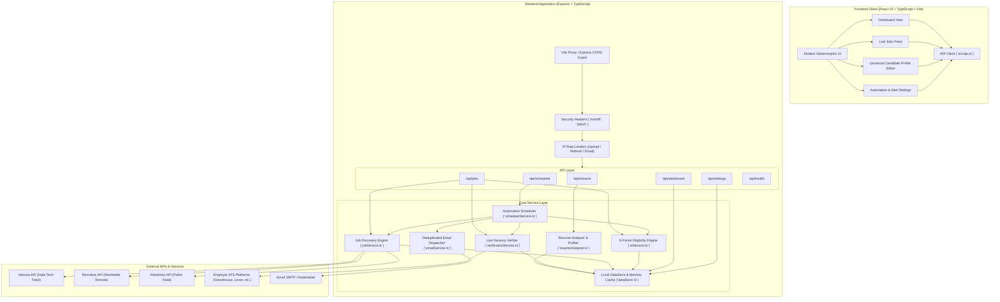
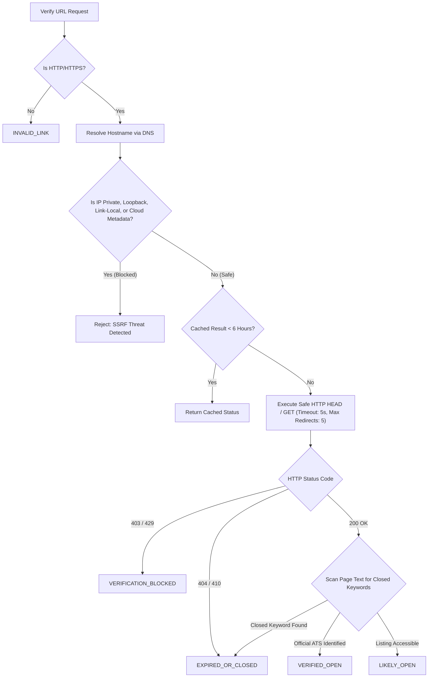

# JobPulse AI — System Architecture & Design Specification

This document provides a comprehensive technical breakdown of the architecture, data flows, security controls, and matching algorithms implemented in JobPulse AI.

---

## 1. High-Level System Architecture

JobPulse AI follows a decoupled client-server architecture designed for reliability, strict data verification, and secure execution.

---

## 2. Component Deep Dives

### 2.1 Universal Resume-Driven Profiler (`resumeAnalyzer.ts`)
The resume analysis service supports diverse educational and engineering disciplines (Cybersecurity, Computer Science, EEE, ECE, Mechanical, Civil, Data/AI, Cloud/DevOps).

- **Magic Byte Validation**: Uploaded files are checked at the binary level before parsing:
  - PDF signatures must start with `%PDF-` (`0x25 0x50 0x44 0x46`).
  - DOCX files must start with the standard ZIP container magic bytes `PK\x03\x04` (`0x50 0x4B 0x03 0x04`).
- **Text Extraction**: Uses `pdf-parse` for PDF streams and `mammoth` for DOCX XML documents. Temporary files are deleted immediately after in-memory parsing.
- **Multidisciplinary Mapping**:
  - Matches degree titles (`B.E.`, `B.Tech`, `M.Tech`, `MCA`, `B.Sc`, `Diploma`).
  - Discovers demonstrated skills, tools, frameworks, and certifications (e.g. CEH, AWS, OCI, Docker, React, Wireshark).
  - Identifies documented projects (e.g. DPDP Act 2023 Compliance & Data Privacy Protection, Adversarial AI Simulator, Multi-Cloud Terraform Infrastructure).
  - Infers experience level (`Fresher`, `Intern`, `Junior`, `Mid-Level`, `Senior`) based solely on graduation dates and documented roles without fabricating years of experience.
- **Interactive Candidate Profile**: Extracted details are serialized into a `CandidateProfile` that users can review and modify directly in the UI.

---

### 2.2 Live Job Discovery Service (`jobService.ts`)
The job engine gathers vacancies only from legitimate, permitted sources and tags them with genuine metadata:

- **Adzuna API**: Connects to the official Adzuna job search API targeting India (`in`) across major tech hubs (Bengaluru, Delhi NCR, Hyderabad, Pune, Mumbai, Chennai).
- **Remotive API**: Pulls public worldwide remote opportunities, verifying remote eligibility for Indian candidates.
- **Arbeitnow API**: Serves as a public European/global tech fallback.
- **Publication Timestamp Fidelity**:
  - Remotive provides ISO 8601 timestamps (`publication_date`) $\rightarrow$ tagged `source_timestamp`.
  - Adzuna provides ISO 8601 timestamps (`created`) $\rightarrow$ tagged `source_timestamp`.
  - Arbeitnow provides Unix timestamps (`created_at`) $\rightarrow$ tagged `source_timestamp`.
  - Any listing missing an explicit source timestamp is marked `postedDateSource: 'unverified'` and excluded from strict 24-hour and 72-hour filters.

---

### 2.3 SSRF-Guarded Vacancy Verification Service (`verificationService.ts`)
To prevent Server-Side Request Forgery (SSRF) and ensure links remain genuine, all URL verification requests undergo rigorous safety validation:

#### Status Tier Definitions:
1. `VERIFIED_OPEN`: The link resolves to an official employer ATS or confirmed application listing.
2. `LIKELY_OPEN`: The page returns HTTP 200 and matches the requisition, but active submission capability is not conclusively proven.
3. `UNKNOWN`: Verification status has not yet been checked or resolved.
4. `EXPIRED_OR_CLOSED`: Conclusive evidence indicates the vacancy is closed (e.g. HTTP 404, or text containing *"job has expired"*, *"no longer accepting applications"*, *"position closed"*).
5. `INVALID_LINK`: Malformed URL, unsupported protocol, or unresolvable domain.
6. `VERIFICATION_BLOCKED`: Access restricted by third-party Cloudflare/bot mitigation (HTTP 403/429). Never falsely reported as closed or open.

---

### 2.4 Structured 5-Factor Matching Engine (`aiService.ts`)
Rather than relying on vague keyword counts, JobPulse AI scores vacancies using a transparent 100-point structured formula:

$$\text{Total Score} = S_{\text{jobFamily}} + S_{\text{skills}} + S_{\text{experience}} + S_{\text{education}} + S_{\text{location}}$$

| Factor | Max Weight | Evaluation Criteria |
| :--- | :---: | :--- |
| **Job Family Match** | **25 pts** | Evaluates alignment between candidate's discipline and the target job family. Unrelated domains (e.g. logistics, sales, fashion) receive heavy deductions. |
| **Technical Skills** | **35 pts** | Compares required and preferred vacancy skills against the candidate's demonstrated skills and tools. |
| **Experience Compatibility** | **15 pts** | Compares candidate experience level against vacancy requirements. Freshers/interns evaluating senior roles (5+ years) receive a maximum of 2 pts and trigger an eligibility concern. |
| **Education & Degree** | **15 pts** | Matches the required degree (e.g. B.E./B.Tech in CS, Cyber Security, EEE, Civil) against candidate education. |
| **Location & Eligibility** | **10 pts** | India-first evaluation. Bengaluru, Delhi NCR, Hyderabad, Pune, Mumbai, Chennai, and India-eligible remote roles receive full marks; unauthorized international onsite roles receive 0–2 pts. |

#### Special Eligibility Guards:
- **Closed Vacancies**: Any vacancy verified as `EXPIRED_OR_CLOSED` automatically receives a match score of **0** and is marked `isEligible: false`.
- **Eligibility Concerns**: Transparent warning messages explaining any mismatch (e.g. *"Requires 5+ years of experience while candidate profile indicates Intern"*).

---

### 2.5 Automation Scheduler & Email Service (`schedulerService.ts`, `emailService.ts`)
- **Scheduler**: Utilizes `node-cron` running daily at 09:00 IST (`0 9 * * *`).
- **Execution Lifecycle**:
  1. Triggers job refresh across active providers.
  2. Runs 5-factor scoring engine against the active candidate profile.
  3. Verifies top candidate links.
  4. Filters for verified active listings matching candidate threshold (`minMatchScore`).
  5. **Deduplication**: Compares candidate jobs against `lastNotifiedJobIds` to ensure users never receive duplicate email alerts for the same requisition.
  6. Sends responsive HTML email digest with verified badges, match scores, and direct application links via Nodemailer.
